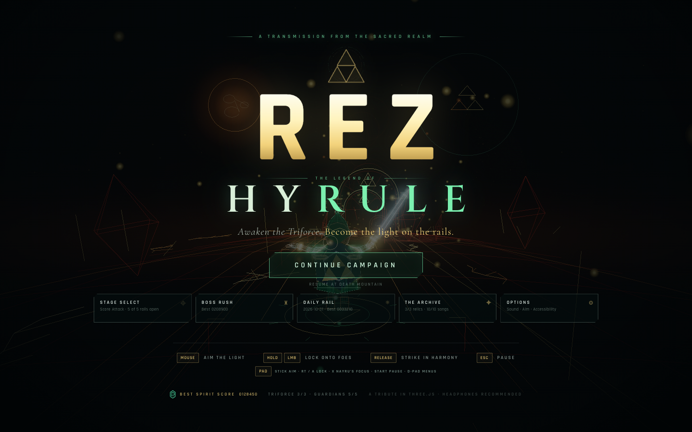
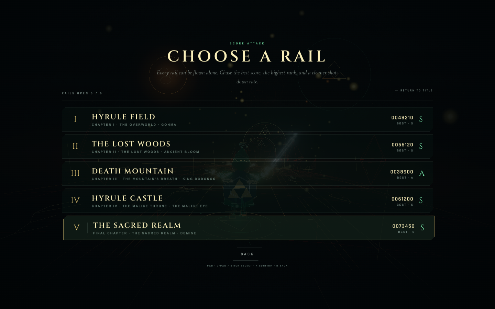
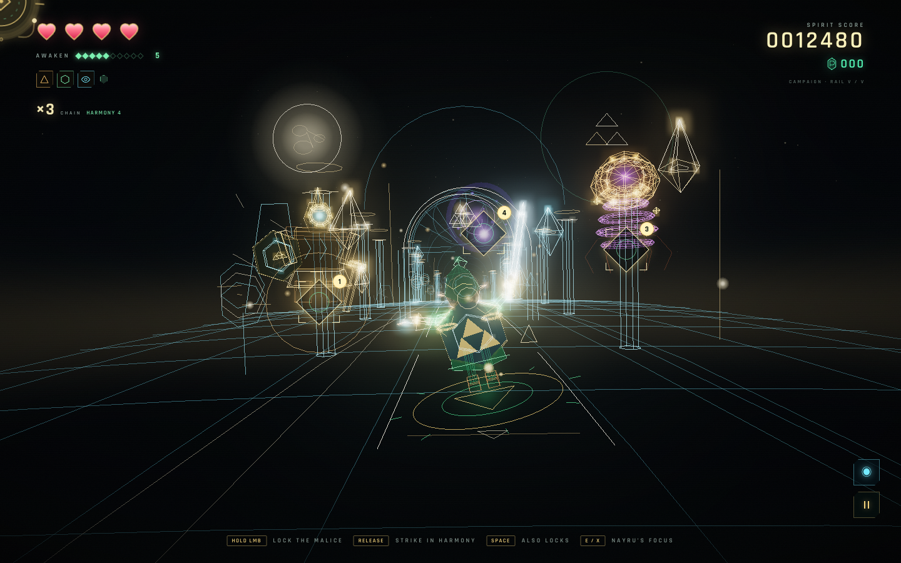
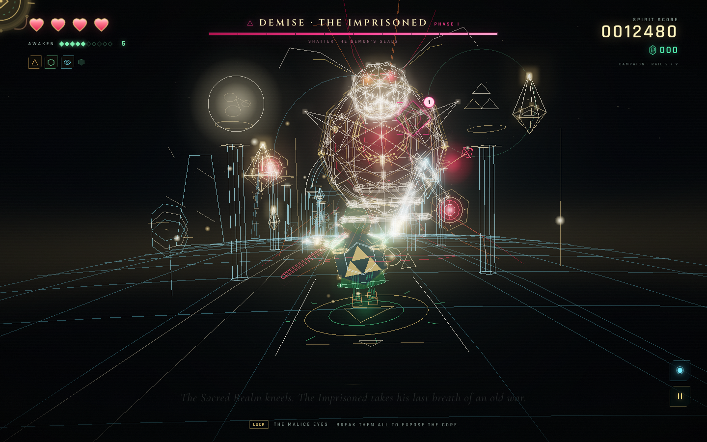
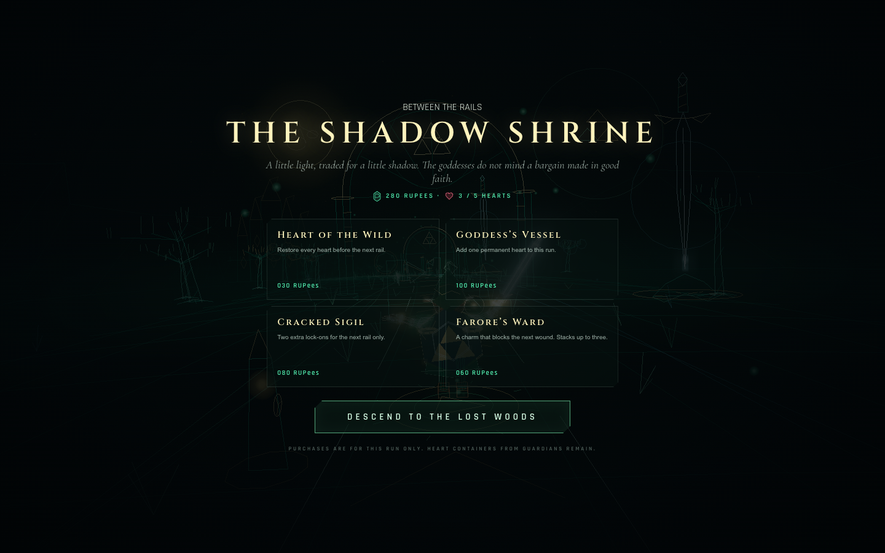
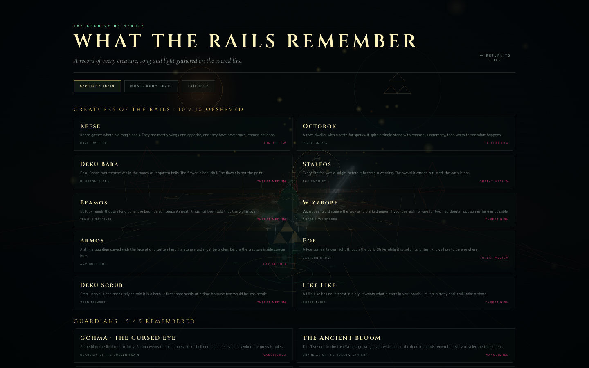
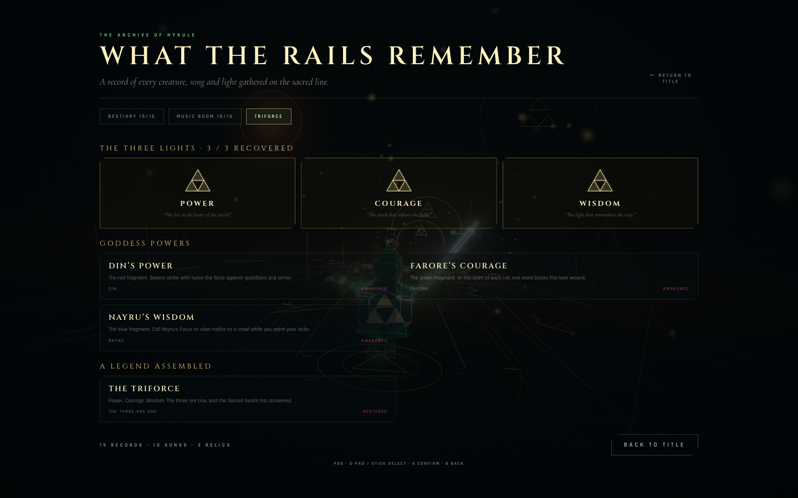
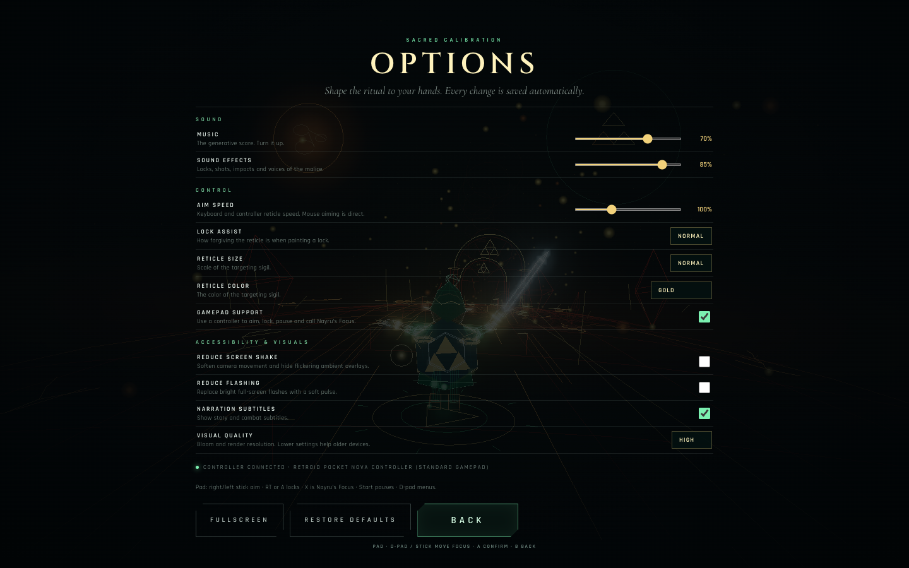
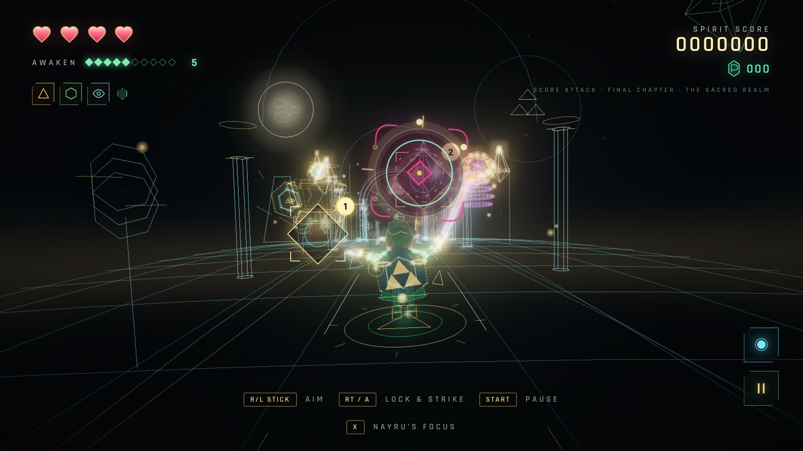

# REZ: HYRULE

**Awaken the Triforce. Become the light on the rails.**

A Rez-inspired rail shooter set in a vector-lit Hyrule, built from scratch with [three.js](https://threejs.org/).
Fly five sacred rails, paint lock-on sigils across the malice, release them in time with a generative
synth-score, and gather the three lights before the oldest demon wakes.

**▶ [Play REZ: HYRULE in your browser](https://rnaud.github.io/rez-hyrule/)**

[](https://rnaud.github.io/rez-hyrule/)

| | |
|:---:|:---:|
| [](screenshots/stage-select.png)<br>**Stage select & Score Attack** | [](screenshots/sacred-realm.png)<br>**The Sacred Realm** |
| [](screenshots/demise.png)<br>**Demise, the Imprisoned** | [](screenshots/shrine.png)<br>**The Shadow Shrine** |
| [](screenshots/archive.png)<br>**The Archive** | [](screenshots/triforce.png)<br>**The Triforce gallery** |

More in [`screenshots/`](screenshots/), including the Music Room, options and mobile layouts.

## Play

The live build is deployed to GitHub Pages: **<https://rnaud.github.io/rez-hyrule/>**

Run it locally:

```bash
npm install
npm run dev
```

Open **http://127.0.0.1:5173** and click **Campaign**. Turn the sound on — the score is part of the game.
Headphones are recommended. The site is also an installable PWA: visit it in Chrome or Safari, install it
from the browser menu, and it will keep playing offline after the first load.

For a production build:

```bash
npm run build
npm run preview
```

Requires Node 20.19+ and a browser with WebGL 2 and Web Audio (current Chrome, Safari, Firefox).

## Modes

| Mode | How it works |
| --- | --- |
| **Campaign** | Five rails, five guardians, one continuous run. The story, shrine and ending live here. Your progress and unlocked rails are saved automatically. |
| **Stage Select / Score Attack** | Replay any rail you have opened as a solo score attack. Each rail keeps its own best score, rank and shot-down rate. |
| **Boss Rush** | Fight all five guardians back to back, with no rails between. Unlocks after your first guardian falls. |
| **Daily Rail** | A date-seeded rail, shared by everyone. Chase today’s best, then copy your result and share it. |
| **The Archive** | A gallery of every creature, guardian, song and Triforce relic you’ve encountered. Listen to the soundtrack from the Music Room. |

## Controls

| Action | Desktop | Touch | Controller |
| --- | --- | --- | --- |
| Aim the reticle | Move the mouse, or arrow keys / WASD | Drag | Left or right stick |
| Lock onto a target | Hold **LMB**, **Space**, or **Z** | Press and hold | RT or A |
| Fire all locks | Release | Release | Release |
| Nayru’s Focus | **E** | ◉ button | X |
| Pause | **Esc** / **P**, or the pause button | Pause button | Start |
| Mute | **M** | Pause menu | — |
| Fullscreen | **F** | — | — |
| Confirm / advance | **Enter** | Tap | A / Start |
| Menu focus | **Tab** | Tap | D-pad / stick |
| Back | **Esc** | — | B |

Sweep the reticle across several enemies while holding to stack locks (four at first, up to eight as you
awaken, and two extra from a shrine sigil). Release to send a volley of homing light. Releasing near the
beat produces **Harmony**; the tighter the timing, the bigger the bonus and the higher your harmony chain
climbs. Every shot is pitched into the current chord, and consecutive harmony releases lift the melody an
octave.

### Controller play — Retroid Pocket Nova & Android handhelds

The game treats the handheld’s built-in controls as a **standard-mapped gamepad**. Press any button or
move a stick once while Chrome is focused; Chrome only exposes a pad to the page after its first input.

| Control | Action |
| --- | --- |
| Right or left stick | Aim the light |
| D-pad | Aim (in-game) / move menu focus |
| RT, LT, or A | Hold to lock; release to fire |
| X or Y | Nayru’s Focus |
| Start or Select | Pause / resume |
| D-pad or stick + A | Choose and confirm in menus |
| B / Select | Back out of menus |

In menus, the first D-pad/stick press puts a gold focus ring on a button. A confirms it. The focused
button is used instead of the default action, so controller-only players can reach Stage Select, options
and the archive.

**Sound on Android:** Chrome’s autoplay policy still requires a real touch/click gesture to start the
Web Audio context. If you begin a run entirely with the controller and the game is silent, a small
**“TAP FOR SOUND”** button appears. One tap of the screen is enough; the controller keeps working.

**Fullscreen / landscape:** use **Fullscreen** in Pause → Options, or install the PWA from Chrome’s menu
(the manifest requests a fullscreen, landscape window). Landscape is the intended layout; aim speed and
lock assist can be tuned in Options.

If the pad is not detected: press a button while the page is focused, make sure the controller is in its
standard/Xbox mode, then reload. The controller path is covered by a standard-gamepad Playwright test in
CI in addition to the normal smoke suite.





The controller help also appears in-game when a pad is detected.

**Take your time.** Foes fly in, then hold station in front of you for several seconds — their targeting
halo appears when they settle. That is your lock-on window. Once it expires they swoop past; a missed foe
costs you its score and rupees, never a heart. Incoming fire is what costs health, and killing the caster
clears its orbs in flight.

## The legend

The kingdom has been stitched shut with malice. As the spirit of the hero, follow the old light through
five rails:

1. **Hyrule Field** — the golden plain, where the Master Sword stands sentinel and Hyrule Castle smoulders on
   the horizon. Guardian: **Gohma, the Cursed Eye**. Fragment: **Power**.
2. **The Lost Woods** — lanterns, hollow trees and a forest that listens. Guardian: **The Ancient Bloom**.
   Fragment: **Courage**.
3. **Death Mountain** — lava fissures, obsidian arches and a volcano breathing embers. Guardian:
   **King Dodongo, the Furnace**. Fragment: **Wisdom**.
4. **Hyrule Castle** — a throne room of malice and the last shade of Ganon. Guardian: **The Malice Eye**.
5. **The Sacred Realm** — a gold-and-glass heaven beyond the last gate. The oldest seal is breaking.
   Guardian: **Demise, the Imprisoned** — the true final boss.

Every guardian yields a heart container and a rest before the next rail. The first three leave a Triforce
fragment; each fragment also awakens a goddess power. The final guardian takes all three lights to answer.

## Systems

### The goddess powers

- **Din’s Power** (red) — your light bites deeper into guardians and their armor.
- **Farore’s Courage** (green) — begin every rail with a ward that absorbs the next wound. A quiet charm
  from the shrine can stack more.
- **Nayru’s Wisdom** (blue) — press **E** / the ◉ button / controller **X** to slow malice to a crawl for
  a few seconds while you paint your locks. Watch the cooldown ring on the ability button.

### Harmony & awaken

- **Harmony** — release on a quarter-note beat for bonus points, extra awaken charge, and a brighter shot.
  A perfect release inside the tight window earns **Perfect Harmony** and a longer chain.
- **Awaken 1→10** — destroy malice to awaken further. Level increases your lock capacity and opens new
  layers of the score (percussion → arpeggio → pads → lead → shimmer). Taking a hit drains awaken charge
  and can pull you back a level.
- **Hearts & heart containers** — start with four hearts. Common enemy fire costs a quarter heart,
  guardian fire costs half; heart drops and permanent containers keep the run alive.

### The Shadow Shrine

Between campaign rails, spend the rupees you have gathered:

- **Heart of the Wild** — restore every heart.
- **Goddess’s Vessel** — add a permanent heart container to this run.
- **Cracked Sigil** — two extra lock-ons for the next rail.
- **Farore’s Ward** — a charm that blocks the next wound; stacks up to three.

### New malice

The bestiary has grown beyond the old field:

- **Armos** — a stone idol whose ward must be cracked before the creature inside takes damage.
- **Poe** — a lantern ghost that phases out of the material world; strike while it is solid.
- **Deku Scrub** — a nervous seed-slinger that fires three seeds in a burst.
- **Like Like** — a slow, greedy sack of a creature. Let it escape and it will steal a handful of rupees.

### Enemies, guardians and the archive

Ten enemy types and five guardians, all procedurally modelled from lines and glow. Every creature you meet
is recorded in **The Archive**, alongside its lore, the 10-track Music Room, and the Triforce gallery.
Defeating guardians fills the three fragments and reveals the assembled Triforce.

### Options & accessibility

- Music and SFX sliders.
- Aim speed for keyboard and controller; lock assist; reticle size and color.
- Reduced screen shake and reduced flashing.
- Narration subtitle toggle.
- Visual quality (High / Medium / Low), controlling bloom and render resolution.
- Full gamepad support for aiming, locking, firing, pausing and Nayru’s Focus.

All settings and progress are stored in `localStorage`; reset progress by clearing the site data.

### Offline PWA

The build ships a service worker and manifest. After one successful load, the entire shell — fonts, hashed
scripts, styles, icons and the game — is cached and can be opened offline. The audio engine and the light
never phone home.

## What's inside

Everything you see and hear is generated at runtime:

- A hand-written procedural **wireframe art library** with an articulated, sword-high hero, a readable
  Hylian shield and palm sigil (Link, Keese, Octoroks, Deku Babas, Stalfos, Beamos, Wizzrobes, Armos,
  Poes, Deku Scrubs, Like Likes, and five guardians). No downloaded models or textures.
- Five **procedural stage corridors** assembled from line batches, each with its own palette, landmarks,
  skyline, gates, particles and lighting mood — from the golden field to the glass heaven of the Sacred
  Realm.
- A **Web Audio synth-score**: ten generative tracks (five rail themes, five guardian themes) with a beating
  kick, sub bass, hats, arps, pads, bell motifs, reverb and tempo-locked player notes. Player shots are
  quantized into the current chord and become part of the music.
- A **bloom post-processing** chain (EffectComposer + UnrealBloomPass + OutputPass) over additive vector
  lines, plus a CSS HUD with a live lock-on reticle, beat ring and chain counter.
- **Gamepad input** with menu focus, **PWA offline caching**, and a Playwright suite covering the title,
  menus, fifth guardian, controller flow, sound prompt and offline shell.

## Project layout

```
index.html               shell + HUD markup
src/main.js              boot, frame loop and service-worker registration
src/style.css            the interface and all screen layouts
src/game/
  Game.js                state machine, modes, waves, powers, scoring, shrine, targeting
  Save.js                versioned localStorage progress, gallery and options
  catalog.js             bestiary lore, power text and Music Room metadata
  World.js               renderer, bloom composer, sky dome, chase camera, quality
  Rail.js                arc-length sampled spline rails
  Player.js              the hero's flight, aura, sword and aiming
  models.js              procedural Link, bestiary, guardian and Demise models
  enemies.js             enemy kinds, behaviours, armor, phasing and formations
  boss.js                five guardian fights, weak points and final-boss patterns
  projectiles.js         malice orbs (targetable!)
  effects.js             particles, shockwaves and homing light beams
  environment.js         procedurally built Field / Woods / Mountain / Castle / Sacred Realm
  stages.js              palettes, songs, poems, bestiary weights, boss and boss-music configs
  AudioEngine.js         generative soundtrack + synthesized SFX
  Hud.js, screens.js     DOM HUD, menus, results, archive, shrine and title/pause screens
  Input.js, util.js      pointer/keyboard/gamepad aiming and math/line-batch helpers
tests/smoke.spec.js      Playwright smoke + offline PWA tests
public/                  manifest, service worker, install icons
src/fonts/               bundled Cinzel, Cormorant Garamond and Rajdhani subsets
screenshots/             captures from the finished build
licenses/                SIL Open Font License texts for the bundled fonts
```

## Development

```bash
npm install
npm run dev        # local dev at http://127.0.0.1:5173
npm run build      # production build
npm run test:ci    # build then run the Playwright smoke/PWA suite
```

The smoke suite needs a production build because the service-worker offline test only runs on the built
site. `npm run test` will use an existing `dist/` and start `vite preview` automatically.

The GitHub Pages deploy workflow runs the same smoke suite before publishing. A separate **Smoke tests**
workflow runs on pull requests.

## Notes

- Browser autoplay policy means the soundtrack begins on your first interaction (the campaign click/keypress).
- Rendering quality is selectable; the default caps at 1.75× device pixel ratio. Bloom is the costly part.
- This is an unofficial fan tribute in the spirit of Sega's **Rez** and Nintendo's **The Legend of Zelda**.
  It is not affiliated with or endorsed by either company. All code, procedural geometry, UI, text and music
  were created for this project. The bundled fonts are used under the SIL Open Font License (see `licenses/`).
