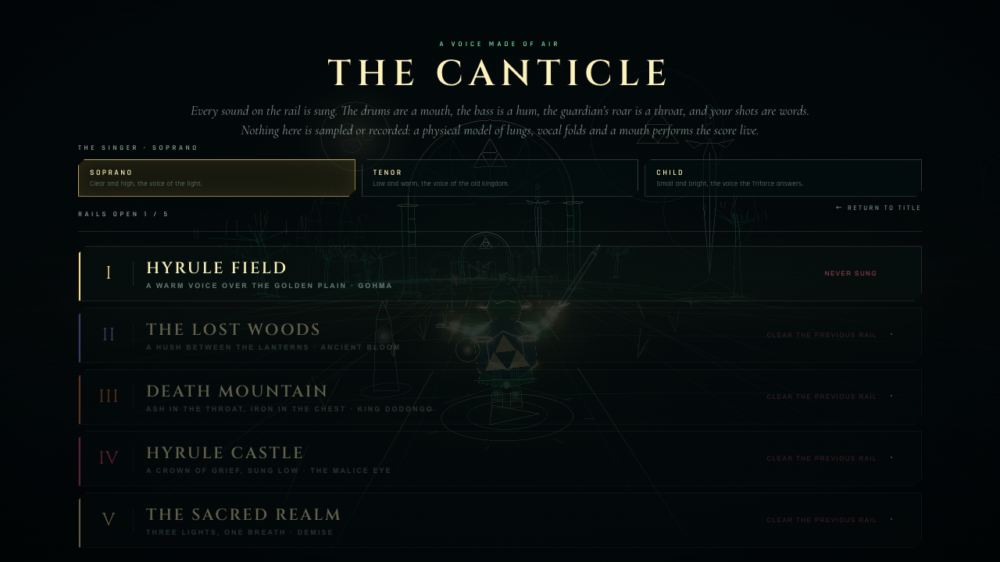
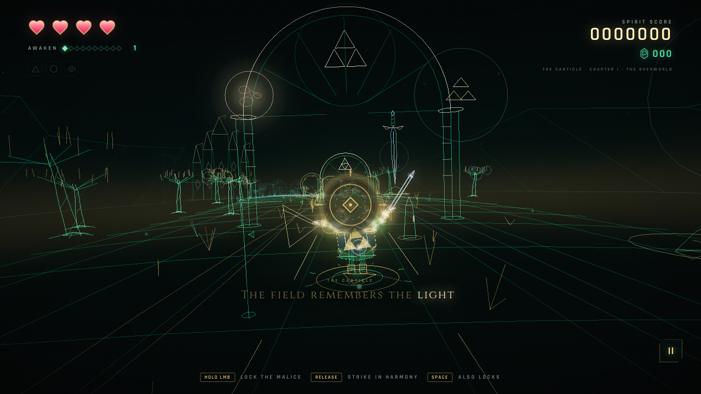

# REZ: HYRULE

**Awaken the Triforce. Become the light on the rails.**

A Rez-inspired rail shooter set in a vector-lit Hyrule, built from scratch with [three.js](https://threejs.org/).
Fly five sacred rails, each with its own palette and its own living score. Paint lock-on sigils across
the malice, release them in time with the music, and gather the three lights before the oldest demon wakes.

Fly them a second way, in **The Canticle**: a mode where every sound on the rail — the drums, the bass,
the guardians, your own shots — is performed by a physical model of a human voice. Nothing is sampled:
a Rust airway simulation (lungs, vocal folds, tongue, lips) sings the stage's words live.

**▶ [Play REZ: HYRULE in your browser](https://rnaud.github.io/rez-hyrule/)**

[](https://rnaud.github.io/rez-hyrule/)

| | |
|:---:|:---:|
| [](screenshots/stage-select.png)<br>**Stage select & Score Attack** | [](screenshots/sacred-realm.png)<br>**The Sacred Realm** |
| [](screenshots/demise.png)<br>**Demise, the Imprisoned** | [](screenshots/shrine.png)<br>**The Shadow Shrine** |
| [](screenshots/archive.png)<br>**The Archive** | [](screenshots/triforce.png)<br>**The Triforce gallery** |

More in [`screenshots/`](screenshots/), including the Music Room, options and mobile layouts.

## Play

The live build is deployed to GitHub Pages: **<https://rnaud.github.io/rez-hyrule/>**

Run it locally:

```bash
npm install
npm run dev
```

Open **http://127.0.0.1:5173** and click **Campaign**. Turn the sound on — the score is part of the game.
Headphones are recommended. The site is also an installable PWA: visit it in Chrome or Safari, install it
from the browser menu, and it will keep playing offline after the first load.

For a production build:

```bash
npm run build
npm run preview
```

Requires Node 20.19+ and a browser with WebGL 2 and Web Audio (current Chrome, Safari, Firefox).

## Modes

| Mode | How it works |
| --- | --- |
| **Campaign** | Five rails, five guardians, one continuous run. The story, shrine and ending live here. Your progress and unlocked rails are saved automatically. |
| **Stage Select / Score Attack** | Replay any rail you have opened as a solo score attack. Each rail keeps its own best score, rank and shot-down rate. |
| **Boss Rush** | Fight all five guardians back to back, with no rails between. Unlocks after your first guardian falls. |
| **Daily Rail** | A date-seeded rail, shared by everyone. Chase today’s best, then copy your result and share it. |
| **The Canticle** | Fly any open rail with a vocalist: the score is sung and beatboxed by a live physical-model voice, with the words on screen as they are sung. |
| **The Archive** | A gallery of every creature, guardian, song and Triforce relic you’ve encountered. Listen to the soundtrack from the Music Room. |

## Controls

| Action | Desktop | Touch | Controller |
| --- | --- | --- | --- |
| Aim the reticle | Move the mouse, or arrow keys / WASD | Drag | Left or right stick |
| Lock onto a target | Hold **LMB**, **Space**, or **Z** | Press and hold | RT or A |
| Fire all locks | Release | Release | Release |
| Nayru’s Focus | **E** | ◉ button | X |
| Pause | **Esc** / **P**, or the pause button | Pause button | Start |
| Mute | **M** | Pause menu | — |
| Fullscreen | **F** | — | — |
| Confirm / advance | **Enter** | Tap | A / Start |
| Menu focus | **Tab** | Tap | D-pad / stick |
| Back | **Esc** | — | B |

Sweep the reticle across several enemies while holding to stack locks (four at first, up to eight as you
awaken, and two extra from a shrine sigil). Release to send a volley of homing light. Releasing near the
beat produces **Harmony**; the tighter the timing, the bigger the bonus and the higher your harmony chain
climbs. Every shot is pitched into the current chord, and consecutive harmony releases lift the melody an
octave.

### Controller play — Retroid Pocket Nova & Android handhelds

The game treats the handheld’s built-in controls as a **standard-mapped gamepad**. Press any button or
move a stick once while Chrome is focused; Chrome only exposes a pad to the page after its first input.

| Control | Action |
| --- | --- |
| Right or left stick | Aim the light |
| D-pad | Aim (in-game) / move menu focus |
| RT, LT, or A | Hold to lock; release to fire |
| X or Y | Nayru’s Focus |
| Start or Select | Pause / resume |
| D-pad or stick + A | Choose and confirm in menus |
| B / Select | Back out of menus |

In Options, Up/Down selects any control, Left/Right adjusts sliders and lists, and A toggles checkboxes. Start resumes a paused run even when another menu action is focused.

In menus, the first D-pad/stick press puts a gold focus ring on a button. A confirms it. The focused
button is used instead of the default action, so controller-only players can reach Stage Select, options
and the archive.

**Sound on Android:** Chrome’s autoplay policy still requires a real touch/click gesture to start the
Web Audio context. If you begin a run entirely with the controller and the game is silent, a small
**“TAP FOR SOUND”** button appears. One tap of the screen is enough; the controller keeps working.

**Fullscreen / landscape:** use **Fullscreen** in Pause → Options, or install the PWA from Chrome’s menu
(the manifest requests a fullscreen, landscape window). Landscape is the intended layout; aim speed and
lock assist can be tuned in Options.

If the pad is not detected: press a button while the page is focused, make sure the controller is in its
standard/Xbox mode, then reload. The controller path is covered by a standard-gamepad Playwright test in
CI in addition to the normal smoke suite.


The controller help also appears in-game when a pad is detected.

**Take your time.** Foes fly in, then hold station in front of you for several seconds — their targeting
halo appears when they settle. That is your lock-on window. Once it expires they swoop past; a missed foe
costs you its score and rupees, never a heart. Incoming fire is what costs health, and killing the caster
clears its orbs in flight.

## The legend

The kingdom has been stitched shut with malice. As the spirit of the hero, follow the old light through
five rails:

1. **Hyrule Field** — a gold-and-emerald plain, where the Master Sword stands sentinel and Hyrule Castle
   smoulders on the horizon. Guardian: **Gohma, the Cursed Eye**. Fragment: **Power**.
2. **The Lost Woods** — a violet forest of lanterns, hollow trees and listening shadows. Guardian:
   **The Ancient Bloom**. Fragment: **Courage**.
3. **Death Mountain** — ember-red lava fissures, obsidian arches and a volcano breathing sparks. Guardian:
   **King Dodongo, the Furnace**. Fragment: **Wisdom**.
4. **Hyrule Castle** — a crimson-and-violet throne room of malice and the last shade of Ganon. Guardian:
   **The Malice Eye**.
5. **The Sacred Realm** — an ivory-and-cyan heaven beyond the last gate. The oldest seal is breaking.
   Guardian: **Demise, the Imprisoned** — the true final boss.

Every guardian yields a heart container and a rest before the next rail. The first three leave a Triforce
fragment; each fragment also awakens a goddess power. The final guardian takes all three lights to answer.

## Five palettes, five scores

The rails no longer share a mood. Each level has a dedicated color identity, and the Music Room confirms
the difference: **Hyrule Field** is a gold-and-emerald plain with a bright, syncopated groove; **The Lost
Woods** is a violet tea-light forest with a sparse, half-time music-box pulse; **Death Mountain** is
ember-red with taiko, anvil hits and a brassy horn lead; **Hyrule Castle** is crimson-and-violet with a
marching organ and harpsichord arpeggios; **The Sacred Realm** is ivory-and-cyan with high bells, choir
pads and flowing glass arpeggios.

Each track now stretches into a 32-bar form instead of repeating one bar forever. The arrangement moves
through a main phrase, a B-section, a breakdown and a climax, with alternate chord progressions and
motifs, drum fills, evolving bass and arpeggio patterns, and small per-run ornaments. Guardian themes use
the same local identity but darken it, and grow more intense as the boss changes phase. Music layers also
open earlier, so each rail establishes its own voice sooner.

Volley feedback starts immediately, while its musical answer plays on sixteenth notes in the current
chord. Echoes follow the stage tempo; the lead and arpeggio briefly step back to leave room for your
phrase. A quiet quarter-note anchor remains through breakdowns. Enemy waves enter on beats, ease off
during breakdowns, and rail bosses enter at bar boundaries. The reticle contracts toward each beat.

Combat uses dark solid enemy silhouettes beneath luminous contours, compact gold lock brackets, and
crisp diamond-shaped projectile cores. Ranged foes turn their acquisition brackets into a contracting
red warning before firing. Scenery fades back during encounters and recovers between them; ambient
motes and the sword's idle glow stay subdued. Active boss targets remain visible against their armor.

## The Canticle — every sound is a voice

The Canticle is another way to fly the rails. Choose a singer, choose an open rail, and the whole
soundtrack is performed live by [CHIMERA](https://github.com/jamesondh/chimera-vocal-synth), a
physical-model voice synthesizer: a Rust simulation of lungs, vocal folds, a branched vocal tract,
lips and nose, compiled to WebAssembly and run inside an AudioWorklet. There are no vocal samples,
no instruments and no audio files in this mode — only a mouth.

Two voices share the engine on the audio thread:

- **The cantor** sings the stage's own line, with real words written for the rail. The notes are
  fitted to each stage's mode and chord progression; the engine gives the consonants their time
  before the beat, glides diphthongs, blooms vibrato on held vowels and breathes at phrase ends.
  The words being sung are drawn along the bottom of the screen, syllable by syllable.
- **The beatboxer** plays the percussion and hums the bass through the engine's articulatory beat
  sequencer. Kicks are lip bursts, snares are lip bursts into a hiss, hats are tongue-tip releases,
  and the bass is a hummed note that follows the bar's chord. More sounds join as you awaken.

Everything else follows: locking a target is a tongue click, a volley is a short sung syllable in
the current chord, a guardian's entrance is a low growl, and the fanfare is sung. The rail's
generative arrangement — the awaken layers, the breakdown's hum, the climax an octave up — still
shapes what the voice does.

| | |
|:---:|:---:|
| [](screenshots/canticle-select.png)<br>**Choose a singer and a rail** | [](screenshots/canticle-play2.png)<br>**The words on screen are the words sung** |

How it works:

- The engine is compiled once (`public/chimera/chimera.wasm`, 1 MB) and both worklet voices
  instantiate it. Planning (lyrics → syllables, pitches → gestures) happens on the main thread;
  the audio thread only renders.
- The beatbox's step sequencer runs on the engine's sample clock, so the drums never drift from
  the rail. The cantor's phrases are planned ahead and scheduled onto the same clock.
- The first breath takes a moment: the mode shows a short "waking the voice" screen while the
  wasm compiles and the airway is built. If the browser cannot start an AudioWorklet, the rail
  offers to fly with the synth score instead.
- Two voices cost about half of one core on a recent laptop, more on older hardware. Options →
  **Canticle ensemble** switches to a single unaccompanied cantor for slower devices; if the engine
  reports a sustained overload, the mode drops the beatboxer on its own and saves that choice.
- The vocalist follows the rail's `bpm`, key and progression, so a stage sounds like the same
  song — in a voice.

## Systems

### Guardian duels keep moving

The rail does not stop when a guardian appears. Link keeps flying at a slower duel speed, the boss holds
its distance ahead of him, and it leans with his lateral movement. The track ends only after a long
runway, and the approach eases down near the end instead of cutting to a frozen arena. Phase changes
still raise the music and the boss patterns.


### The goddess powers

- **Din’s Power** (red) — your light bites deeper into guardians and their armor.
- **Farore’s Courage** (green) — begin every rail with a ward that absorbs the next wound. A quiet charm
  from the shrine can stack more.
- **Nayru’s Wisdom** (blue) — press **E** / the ◉ button / controller **X** to slow malice to a crawl for
  a few seconds while you paint your locks. Watch the cooldown ring on the ability button.

### Harmony & awaken

- **Harmony** — release on a quarter-note beat for bonus points, extra awaken charge, and a brighter shot.
  A perfect release inside the tight window earns **Perfect Harmony** and a longer chain.
- **Awaken 1→10** — destroy malice to awaken further. Level increases your lock capacity and opens new
  layers of the score (percussion → arpeggio → pads → lead → shimmer). Taking a hit drains awaken charge
  and can pull you back a level.
- **Hearts & heart containers** — start with four hearts. Common enemy fire costs a quarter heart,
  guardian fire costs half; heart drops and permanent containers keep the run alive.

### The Shadow Shrine

Between campaign rails, spend the rupees you have gathered:

- **Heart of the Wild** — restore every heart.
- **Goddess’s Vessel** — add a permanent heart container to this run.
- **Cracked Sigil** — two extra lock-ons for the next rail.
- **Farore’s Ward** — a charm that blocks the next wound; stacks up to three.

### New malice

The bestiary has grown beyond the old field:

- **Armos** — a stone idol whose ward must be cracked before the creature inside takes damage.
- **Poe** — a lantern ghost that phases out of the material world; strike while it is solid.
- **Deku Scrub** — a nervous seed-slinger that fires three seeds in a burst.
- **Like Like** — a slow, greedy sack of a creature. Let it escape and it will steal a handful of rupees.

### Enemies, guardians and the archive

Ten enemy types and five guardians, all procedurally modelled from lines and glow. Every creature you meet
is recorded in **The Archive**, alongside its lore, the 10-track Music Room, and the Triforce gallery.
Defeating guardians fills the three fragments and reveals the assembled Triforce.

### Options & accessibility

- Music and SFX sliders.
- Aim speed for keyboard and controller; lock assist; reticle size and color.
- Reduced screen shake and reduced flashing.
- Narration subtitle toggle.
- Visual quality (High / Medium / Low), controlling bloom and render resolution.
- Full gamepad support for aiming, locking, firing, pausing and Nayru’s Focus.

All settings and progress are stored in `localStorage`; reset progress by clearing the site data.

### Offline PWA

On Android, open the HTTPS site in Chrome and choose **Options → Install app**, then tap the button to accept the browser installation prompt. If no prompt is available, use **Chrome menu → Add to Home screen → Install**. Launch from the home screen for fullscreen landscape play. Load the game online once before going offline. Pair your Bluetooth or USB controller, then press a button with the game focused.

The build ships a service worker and manifest. After one successful load, the entire shell — fonts, hashed
scripts, styles, icons and the game — is cached and can be opened offline. The audio engine and the light
never phone home.

## What's inside

Everything you see and hear is generated at runtime:

- A hand-written procedural **wireframe art library** with an articulated, sword-high hero, a readable
  Hylian shield and palm sigil (Link, Keese, Octoroks, Deku Babas, Stalfos, Beamos, Wizzrobes, Armos,
  Poes, Deku Scrubs, Like Likes, and five guardians). No downloaded models or textures.
- Five **procedural stage corridors** assembled from line batches, each with its own palette, landmarks,
  skyline, gates, particles and lighting mood — from the gold-and-emerald field through the violet woods,
  ember mountain and crimson castle to the ivory-glass Sacred Realm.
- A **Web Audio synth-score**: ten generative tracks (five rail themes, five guardian themes), each with a
  stage-specific drum language, bass line, arpeggio voice, pad color and lead instrument. Longer A/B/C
  forms, fills and per-run ornaments keep the loop alive; player shots are quantized into the current
  chord and become part of the music.
- **The Canticle**, a vocal mode running the MIT-licensed [CHIMERA](https://github.com/jamesondh/chimera-vocal-synth)
  physical-model voice: a Rust airway simulation compiled to WebAssembly, two AudioWorklet voices (a
  cantor and a beatboxer), original lyrics fitted to each stage's harmony, and a karaoke line that shows
  the words as they are sung. No vocal samples or recordings are shipped.
- A **bloom post-processing** chain (EffectComposer + UnrealBloomPass + OutputPass) over additive vector
  lines, plus a CSS HUD with a live lock-on reticle, beat ring and chain counter.
- **Gamepad input** with menu focus, **PWA offline caching**, and a Playwright suite covering the title,
  menus, fifth guardian, controller flow, sound prompt, the vocal mode and offline shell.

## Project layout

```
index.html               shell + HUD markup
src/main.js              boot, frame loop and service-worker registration
src/style.css            the interface and all screen layouts
src/game/
  Game.js                state machine, modes, waves, powers, scoring, shrine, targeting
  Save.js                versioned localStorage progress, gallery and options
  catalog.js             bestiary lore, power text and Music Room metadata
  World.js               renderer, bloom composer, sky dome, chase camera, quality
  Rail.js                arc-length sampled spline rails
  Player.js              the hero's flight, aura, sword and aiming
  models.js              procedural Link, bestiary, guardian and Demise models
  enemies.js             enemy kinds, behaviours, armor, phasing and formations
  boss.js                five guardian fights, weak points and final-boss patterns
  projectiles.js         malice orbs (targetable!)
  effects.js             particles, shockwaves and homing light beams
  environment.js         procedurally built Field / Woods / Mountain / Castle / Sacred Realm
  stages.js              palettes, songs, poems, bestiary weights, boss and boss-music configs
  AudioEngine.js         generative soundtrack + synthesized SFX
  Hud.js, screens.js     DOM HUD, menus, results, archive, shrine and title/pause screens
  Input.js, util.js      pointer/keyboard/gamepad aiming and math/line-batch helpers
src/chimera/
  engine.js              main-thread facade over the wasm engine (planning, lyrics, catalog)
  CanticleAudio.js       the vocal score: two AudioWorklet voices, beatbox patterns, sung effects
  canticle.js            original lyrics, melodies in each stage's mode and beatbox patterns
  lyrics.js              syllables precomputed with CMUdict (generated)
scripts/build-chimera-wasm.sh     rebuilds public/chimera/chimera.wasm from the pinned engine commit
scripts/build-canticle-lyrics.mjs  regenerates src/chimera/lyrics.js from the lyric lines
scripts/render-canticle.mjs       offline render + pitch analysis of the vocalist
public/chimera/          the compiled engine and its AudioWorklet (served as-is)
public/                  manifest, service worker, install icons
tests/smoke.spec.js      Playwright smoke + offline PWA tests
tests/canticle.spec.js   the vocal mode: wake, sing, return to the synth score
src/fonts/               bundled Cinzel, Cormorant Garamond and Rajdhani subsets
screenshots/             captures from the finished build
licenses/                SIL Open Font License texts for the bundled fonts, and CHIMERA’s MIT licence
```

## Development

```bash
npm install
npm run dev        # local dev at http://127.0.0.1:5173
npm run build      # production build
npm run test:ci    # build then run the Playwright smoke/PWA suite
```

The smoke suite needs a production build because the service-worker offline test only runs on the built
site. `npm run test` will use an existing `dist/` and start `vite preview` automatically.

The GitHub Pages deploy workflow runs the same smoke suite before publishing. A separate **Smoke tests**
workflow runs on pull requests.

### Rebuilding the voice

The compiled engine is committed, so the ordinary build needs no Rust toolchain. To move The Canticle
to a newer engine, or to change a lyric line:

```bash
npm run canticle:wasm     # clone the pinned MIT engine, build wasm32-unknown-unknown, copy the .wasm
npm run canticle:lyrics   # re-print every lyric line with CMUdict and rewrite src/chimera/lyrics.js
npm run canticle:render   # render a rail offline and report the sung pitch against the score
```

`scripts/render-canticle.mjs --stage castle --boss --out shots/castle.wav` auditions a rail (or a
guardian) without opening the game; `--analyze` measures the singer's f0 against the intended notes.
The engine's own documentation lives in the [CHIMERA repository](https://github.com/jamesondh/chimera-vocal-synth).

## Notes

- Browser autoplay policy means the soundtrack begins on your first interaction (the campaign click/keypress).
- Rendering quality is selectable; the default caps at 1.75× device pixel ratio. Bloom is the costly part.
- The Canticle's two voices are simulated airways, not samples: expect them to use a noticeable slice of
  one CPU core. The **Canticle ensemble** option and the automatic beatboxer fallback keep slower devices
  playable, and the mode always offers the synth score if a browser refuses AudioWorklet.
- This is an unofficial fan tribute in the spirit of Sega's **Rez** and Nintendo's **The Legend of Zelda**.
  It is not affiliated with or endorsed by either company. All code, procedural geometry, UI, text and music
  were created for this project. The bundled fonts are used under the SIL Open Font License (see `licenses/`).
- The vocal engine, its AudioWorklet adapter and the singing planner are from
  [CHIMERA](https://github.com/jamesondh/chimera-vocal-synth) by Jameson Hodge, used under the MIT licence
  (`licenses/chimera-MIT.txt`). The sung words, melodies and beatbox patterns were written for this game.
